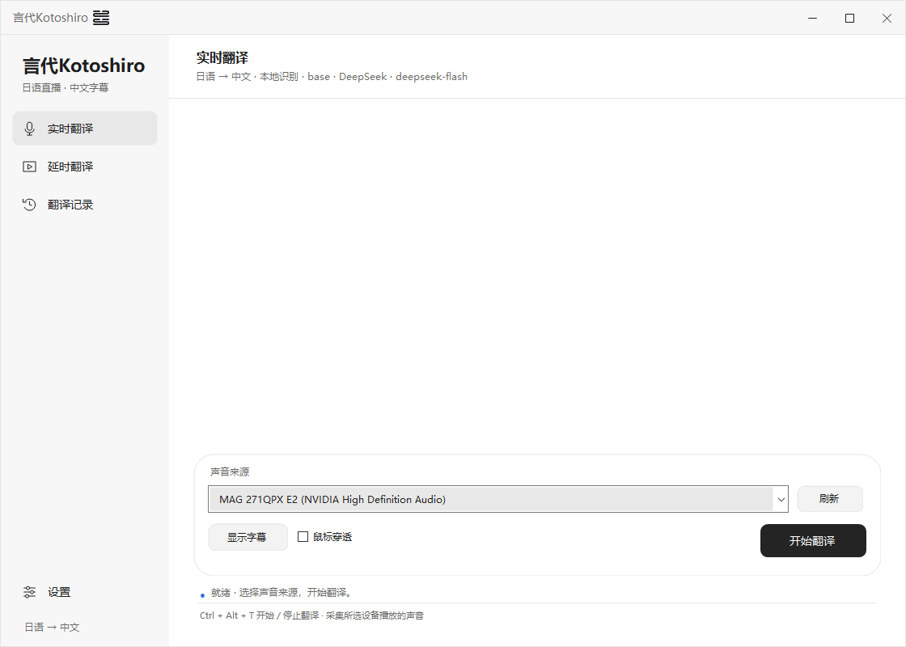
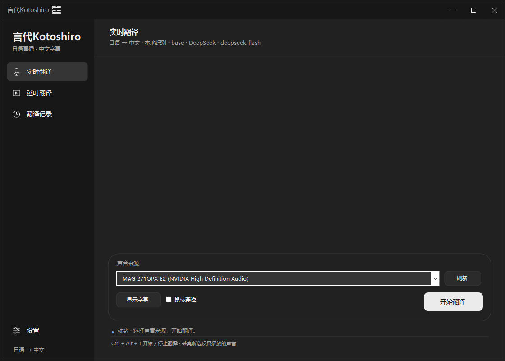

# 言代Kotoshiro

面向 Windows 的日语直播中文字幕工具，可识别电脑播放的声音，也可在独立播放器中观看 B 站直播，为识别和翻译预留视频延迟。

当前版本：**v0.9.10**。这是持续开发中的原型，不同配置电脑和长时间直播仍需要实测。



## 下载与使用

在 [Releases](https://github.com/SakumaNemu-258/Yandai-Kotoshiro/releases) 下载 Windows x64 压缩包，完整解压后运行 `Kotoshiro.exe`。请保留同目录的 `engine` 和 `player` 文件夹。

适用于 Windows 10 / 11 的 64 位电脑。

1. 打开设置，配置文字翻译的服务商、API 地址、密钥和模型。
2. 选择本地语音识别或 API 识别。识别服务和文字翻译服务分别配置；API 识别无需下载本地识别模型。
3. 本地识别可自选模型存放文件夹，并提供显卡加速设置。
4. 在“实时翻译”中选择声音来源并开始翻译；或在“延时翻译”中输入 B 站直播间地址。

详细操作见 [使用说明](使用说明.txt)。软件设置、密钥和账号凭证留在各自电脑上，不包含在仓库和下载包中。

## 功能

- 实时翻译、B 站延时翻译、翻译记录三个入口。
- 本地语音识别和兼容语音 API 的识别方式。
- 多种文字翻译 API，可自填服务地址、密钥和模型。
- 可调整的翻译上下文：默认 3 段，范围 0～30 段。
- 自定义术语表，支持 TXT 导入、导出及默认示例。
- 黑白主题、透明线条标题标志、多行字幕与可滚动历史。
- B 站直播清晰度切换、刷新、全屏、可收起的评论区，以及扫码登录和发送弹幕。
- 识别、翻译和排队等环节的耗时记录。



## 从源码构建

需要 Windows、.NET 8 SDK 和网络连接。在仓库根目录打开 PowerShell：

```powershell
.\build.ps1
```

脚本发布自包含 Windows x64 程序，并下载经过 SHA-256 校验的 whisper.cpp、mpv 和 FFmpeg 运行组件，输出到 `artifacts`。也可通过 `-Destination` 指定输出目录。

仅构建主程序：

```powershell
dotnet publish .\Kotoshiro.csproj -c Release -r win-x64 --self-contained true -p:PublishSingleFile=true -p:IncludeNativeLibrariesForSelfExtract=true -p:DebugType=None -p:DebugSymbols=false -o .\artifacts
```

单独构建的主程序需要补齐运行组件，才能使用本地识别和直播播放器。

## 验证

v0.9.10 发布构建完成，85 项自动检查通过；黑白主题均已进行实际窗口截图检查。检查记录在 [docs/verification-v0.9.10.txt](docs/verification-v0.9.10.txt)。本次版本验证没有调用付费识别或翻译 API，也没有重新测试实际直播；账号授权及实际订阅翻译尚未实测。

用自己的构建运行自动检查：

```powershell
$test = Start-Process -FilePath .\artifacts\Kotoshiro.exe -ArgumentList '--self-test', 'self-test-output' -WindowStyle Hidden -Wait -PassThru
Get-Content .\self-test-output\self-test.txt
```

检查输出使用独立目录。`--preview` 模式也可生成界面预览：

```powershell
dotnet .\bin\Release\net8.0-windows\win-x64\Kotoshiro.dll --preview .\preview-output light
```

## 第三方组件

NAudio、QRCoder、.NET、whisper.cpp、mpv、FFmpeg 等组件的许可证随仓库提供，具体来源与版本见 [播放器组件来源](播放器组件来源.txt)。`player-upstream` 保留对应播放器构建和源码归档；这些归档沿用其各自许可证。

标题栏与应用图标资源位于 `Assets`。当前应用图标采用白底黑线版本，标题栏透明线条仍随黑白主题切换。

`AppIcon.ico` 由白色版 SVG 导出，包含 16～256 像素的七个尺寸，16 像素使用专门的小图形。需要重新导出图标时，可在安装了 `sharp` 的 Node.js 环境执行 `node Assets/export-app-icon.cjs`；正常构建直接使用已保存的 ICO。
